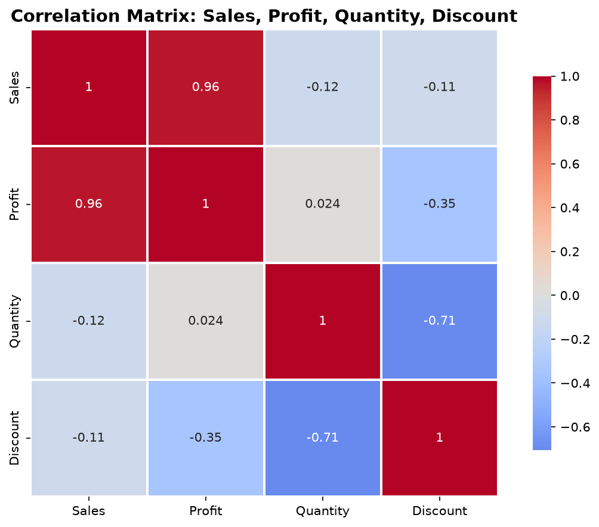
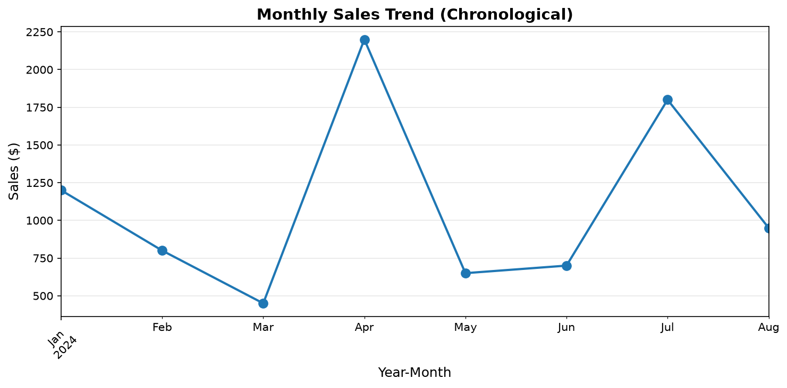
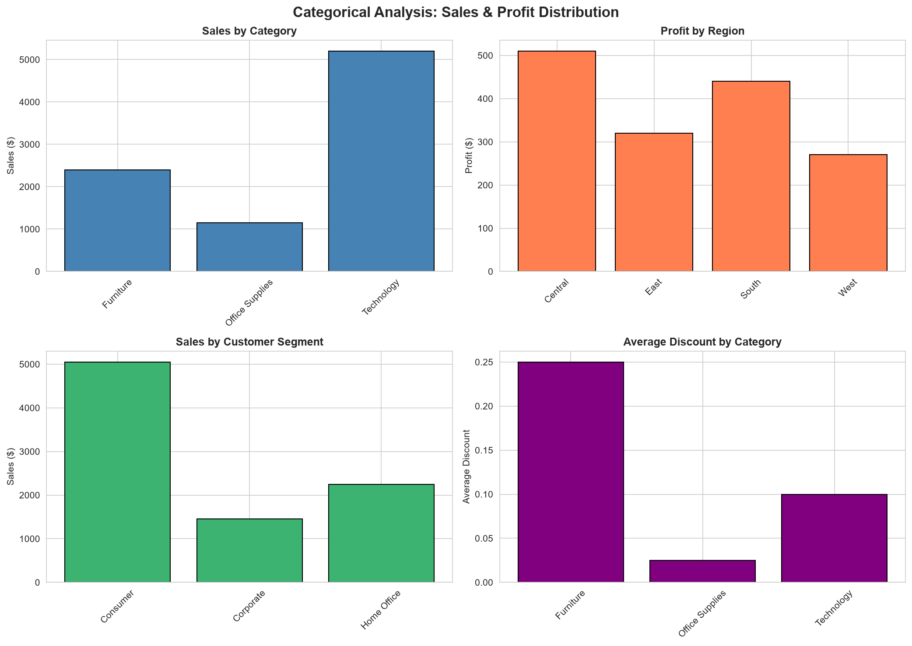
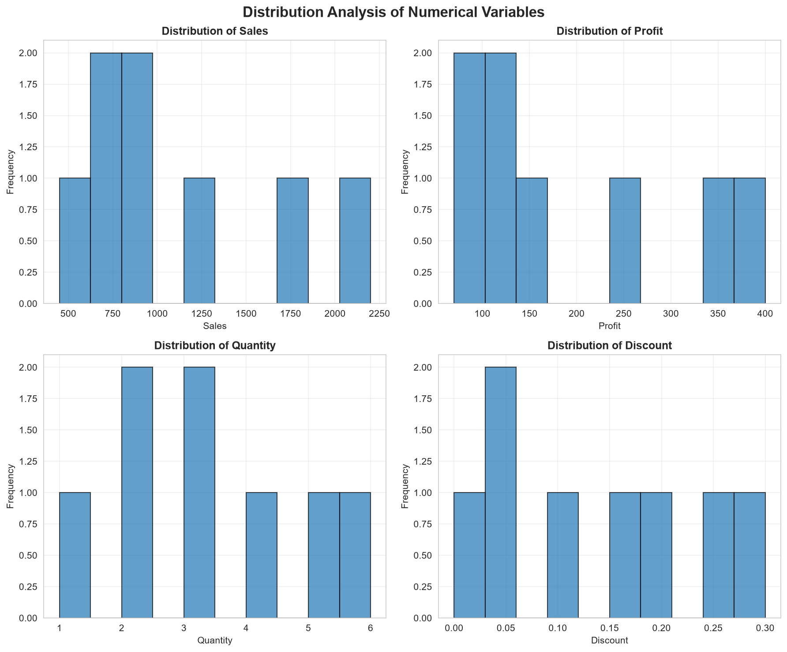

# Exploratory Data Analysis (EDA) Project

A Python script that performs a complete, structured EDA pipeline on a small retail-sales dataset — covering data quality auditing, descriptive statistics, correlation analysis, time-based aggregation, and categorical and distribution visualizations. All output charts and summaries are saved to `outputs/`.

> ⚠️ **Small-sample notice:** The included dataset has only **8 rows**. All findings are illustrative of EDA methodology and **must not** be used for business decisions or statistical inference.

---

## Features

| Capability | Detail |
|---|---|
| **Data quality audit** | Shape, nulls, duplicates, memory usage, unique-value counts |
| **Descriptive statistics** | mean, median, std, mode, skewness, kurtosis for all numeric columns |
| **Correlation analysis** | Pearson correlation matrix + heatmap (Sales, Profit, Quantity, Discount) |
| **Time-based analysis** | Year-month aggregation (prevents mixing of same-month across years) |
| **Categorical analysis** | Sales by Category, Profit by Region, Sales by Segment, Avg Discount by Category |
| **Distribution analysis** | Histogram panel for all four numeric variables |
| **Data cleaning** | Duplicate removal, `Order Date` → `datetime` conversion |
| **Persistent outputs** | All plots (PNG, 150 dpi) and summaries (CSV, TXT) written to `outputs/` |
| **Validation** | Required-column check and empty-dataframe guard on load |

---

## Tech Stack

| Layer | Library | Version |
|---|---|---|
| Language | Python | 3.10+ |
| Data manipulation | pandas | ≥ 2.0.0 |
| Numerical ops | NumPy | ≥ 1.24.0 |
| Plotting | Matplotlib | ≥ 3.7.0 |
| Styled plots | Seaborn | ≥ 0.12.0 |

---

## Dataset

**File:** `data/SampleSuperstore.csv`

| Field | Type | Values |
|---|---|---|
| Order Date | datetime | 2024-01-10 → 2024-08-30 |
| Category | categorical | Technology, Furniture, Office Supplies |
| Region | categorical | East, West, South, Central |
| Customer Segment | categorical | Consumer, Corporate, Home Office |
| Quantity | int | 1 – 6 |
| Discount | float | 0.00 – 0.30 |
| Sales | float | \$450 – \$2,200 |
| Profit | float | \$70 – \$400 |

8 rows · 8 columns · 0 missing values · 0 duplicates

---

## Prerequisites

- Python 3.10 or later
- `pip` (bundled with Python)

---

## Installation

```bash
# 1. Clone
git clone https://github.com/nfsprogramming/Exploratory-Data-Analysis-EDA-Project.git
cd Exploratory-Data-Analysis-EDA-Project

# 2. Create a virtual environment
python -m venv .venv

# 3. Activate it
# Windows
.venv\Scripts\activate
# macOS / Linux
source .venv/bin/activate

# 4. Install dependencies
pip install -r requirements.txt
```

---

## Usage

```bash
python eda_analysis.py
```

The script logs progress to stdout and writes all outputs to `outputs/`:

```
outputs/
├── correlation_heatmap.png       ← heatmap of Sales/Profit/Quantity/Discount
├── correlation_matrix.csv        ← numerical Pearson values
├── monthly_sales_trend.png       ← chronological year-month sales line chart
├── categorical_analysis.png      ← 2×2 panel: category, region, segment, discount
├── sales_by_category.png         ← standalone category bar chart
├── profit_by_region.png          ← standalone region bar chart
├── distribution_analysis.png     ← 2×2 histogram panel
├── descriptive_statistics.csv    ← describe() + median / mode / skew / kurtosis
├── data_quality_audit.csv        ← audit metadata row
└── dataset_info.txt              ← plain-text summary
```

---

## Visualizations

### Correlation Heatmap


Pearson correlations between the four numeric variables. With n = 8, treat values as directional indicators only.

### Monthly Sales Trend


Sales aggregated by year-month (Jan–Aug 2024).

### Categorical Analysis


2×2 panel: Sales by Category · Profit by Region · Sales by Customer Segment · Average Discount by Category.

### Distribution Analysis


Histograms of Sales, Profit, Quantity, and Discount.

---

## Project Structure

```
EDA_Project/
├── data/
│   └── SampleSuperstore.csv      ← source dataset (8 rows, 8 columns)
├── outputs/                      ← generated charts and summaries
├── eda_analysis.py               ← main analysis script
├── EDA_Report.md                 ← written analysis report
├── requirements.txt
├── .gitignore
├── LICENSE                       ← MIT
└── README.md
```

---

## Key Findings (Illustrative)

> All values are computed from the 8-row sample dataset. Do not generalize.

| Metric | Value |
|---|---|
| Sales range | \$450 – \$2,200 |
| Profit range | \$70 – \$400 |
| Sales–Profit correlation | 0.96 (strong positive) |
| Quantity–Discount correlation | −0.71 (strong negative) |
| Discount–Sales correlation | −0.11 (weak negative) |
| All transactions profitable | ✅ Yes |

---

## Limitations

- **n = 8:** No statistical power; confidence intervals are unreliable.
- **8-month span:** Seasonality and long-run trends cannot be detected.
- **Unknown representativeness:** The sample may not reflect a real population.
- **No causal claims:** Correlation ≠ causation.
- **No hypothesis testing:** Sample size precludes meaningful significance tests.

---

## Contributing

1. Fork the repository.
2. Create a feature branch: `git checkout -b feature/your-feature`.
3. Commit your changes: `git commit -m "Add your feature"`.
4. Push: `git push origin feature/your-feature`.
5. Open a pull request.

---

## License

[MIT](LICENSE) © 2024 nfsprogramming
